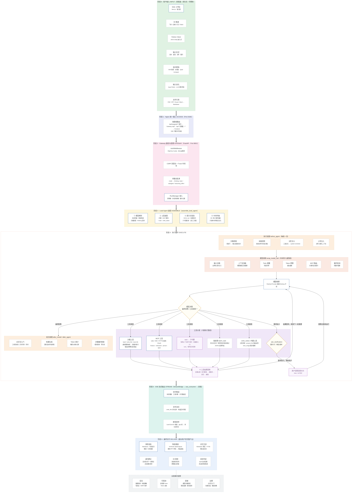
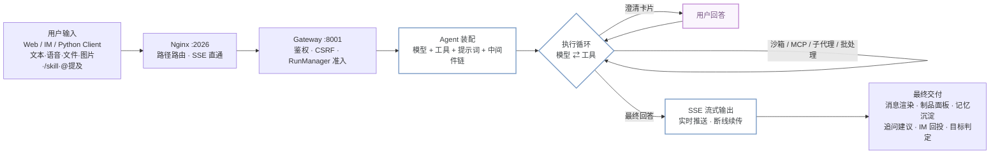

# DeerFlow 2.0 用户输入 → 输出生成 全流程（Mermaid 版）

> 与 `user-flow.html` 严格对齐：七个阶段、相同的配色（绿→靛→粉→黄→橙/紫→青→蓝）、相同的模块内容。
> 直接在支持 Mermaid 的渲染器中查看（GitHub / Typora / VS Code 插件均可）。

## 全流程总图

## 简化版（一图速览）

## 图例说明

| 元素 | 含义 | 对应 HTML |
|---|---|---|
| 蓝色描边节点 | 核心模块（Web 工作台、RunManager、装配四步、模型、沙箱/MCP 工具、SSE 推送、消息渲染、制品落盘） | `.box.core` / `.branch.core` |
| 金色菱形 | 决策点（模型输出决策、澄清决策） | `.box.decision` |
| 紫色节点 | 循环回路（子代理、工具结果回传、用户澄清回答） | `.box.loop` / 紫色回环标注 |
| 粗实线 `==>` | 阶段间主链路（阶段 0 → 6 单脊柱串联） | 层间箭头 |
| 隐形链 `~~~` | 子图内节点排序（仅控制布局，不画箭头） | 带内 boxes 排列 |
| 灰底虚线框 | 横切保障（不参与主流程） | `.band.b-gray` |

关键回路：

1. **模型 ⇄ 工具循环**：`RESULT → MODEL`，工具结果回传驱动多轮推理，直至产出最终回答。
2. **自我纠错闭环**：沙箱执行报错 → 读错误 → 改写 → 重跑（RESULT 节点标注）。
3. **澄清回路**：`T5 → CLARIFY → MODEL`，澄清卡片暂停执行，用户回答后从模型调用处接续。
4. **目标回路**（阶段 6 · D6）：`/goal` 未达成时持续推进，而非直接收尾。
